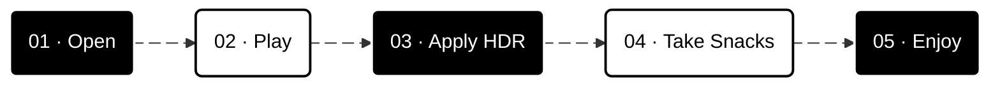
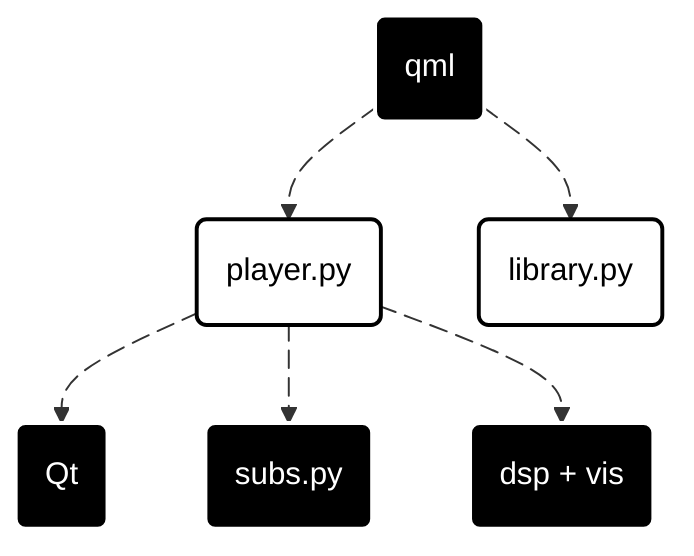

<div align="center">

</div>

<table>
<tr>
<td width="42%" align="center" valign="middle">


<br><br>

<a href="https://github.com/DemoLab/readme-typing-svg"></a>

</td>
<td width="58%" valign="middle">


<br><br>

```text
╭─ FLOW INDEX ───────────────────────╮
│  [01] SYSTEM   ~►  #01-system      │
│  [02] KEYS     ~►  #02-keys        │
│  [03] BOOT     ~►  #03-boot        │
│  [04] FAQ      ~►  #04-faq         │
╰────────────────────────────────────╯
```

</td>
</tr>

<div align="center">



</div>

## 01. system

<table>
<tr>
<td width="50%" valign="top">


<br>

- **Library:** auto-sorts movies, series, extras, audio
- **Playback:** resume halfway · shuffle/repeat queue · `0.5x–2x`

</td>
<td width="50%" valign="top">


<br>

- **Video (17):** `mp4 mkv avi mov webm flv m2ts wmv mpg vob` +
- **Audio (12):** `mp3 flac wav aac m4a ogg opus wma aiff mka` +
- **Stream:** `http` `https` `rtsp` `rtmp`

</td>
</tr>
<tr>
<td width="50%" valign="top">


<br>

| look | bright | contrast | colour | warmth | vig |
|:--|:--:|:--:|:--:|:--:|:--:|
| `OFF` | `0` | `0` | `0` | `0` | `0` |
| `HDR` | `+0.04` | `+0.22` | `+0.20` | `0` | `0` |
| `CIN` | `-0.03` | `+0.16` | `-0.10` | `+0.35` | `0.45` |
| `VIB` | `+0.02` | `+0.10` | `+0.45` | `0` | `0` |

<sub>+ independent `2.39:1` bars switch</sub>

</td>
<td width="50%" valign="top">


<br>

- **Auto:** `.srt .ass .ssa .vtt .sub` & `Subs/`
- **Embedded:** `MKV` · `MP4/MOV (mov_text)` · `ffmpeg`
- **No bitmap:** PGS / VobSub / DVB
- **Live:** drop file or **`Shift+C`** · **`Z/X`** ±0.1s

</td>
</tr>
</table>

## 02. keys

<table>
<tr>
<td width="33%" valign="top">


| key | action |
|:--|:--|
| **`Space` `K`** | play / pause |
| **`<-` `->`** | skip (`Shift` big) |
| **`N` `P`** | next / prev |
| **`[` `]`** | speed |

</td>
<td width="33%" valign="top">


| key | action |
|:--|:--|
| **`Up` `Down`** | volume |
| **`M`** | mute |
| **`V`** | cycle look |
| **`F` `F11`** | fullscreen |

</td>
<td width="34%" valign="top">


| key | action |
|:--|:--|
| **`C` / `Shift+C`** | subs / load |
| **`Z` `X`** | sync ±0.1s |
| **`Ctrl+O/B/L/,`** | open/lib/queue/set |
| **`Esc`** | back / close |

</td>
</tr>
</table>

## 03. boot

<table>
<tr>
<td width="52%" valign="top">


<br>

**Windows** — Python 3.10+ (PATH) → `manage.bat` → **`I`**

```text
╭─ [I] install + shortcuts   [U] uninstall   [Q] quit ─╮
```

**Linux**

```bash
./manage.sh install && ./run.sh
```

</td>
<td width="48%" valign="middle">



<sub>data saved in `./data` · `numpy` optional</sub>

</td>
</tr>
</table>

## 04. faq

<table>
<tr>
<td width="50%" valign="top">

<details>
<summary><b>Picture button missing?</b></summary>
Only appears when a video is loaded.
</details>

<details>
<summary><b>Python not found?</b></summary>
Install Python 3.10+ and tick Add to PATH.
</details>

</td>
<td width="50%" valign="top">

<details>
<summary><b>Where do settings go?</b></summary>
Everything stays in <code>./data</code> on uninstall.
</details>

<details>
<summary><b>Subtitles not showing?</b></summary>
Image subs (PGS/VobSub) are unsupported; use <code>.srt</code>.
</details>

</td>
</tr>
</table>

<div align="center">


<sub><code>made by xan</code></sub>
</div>